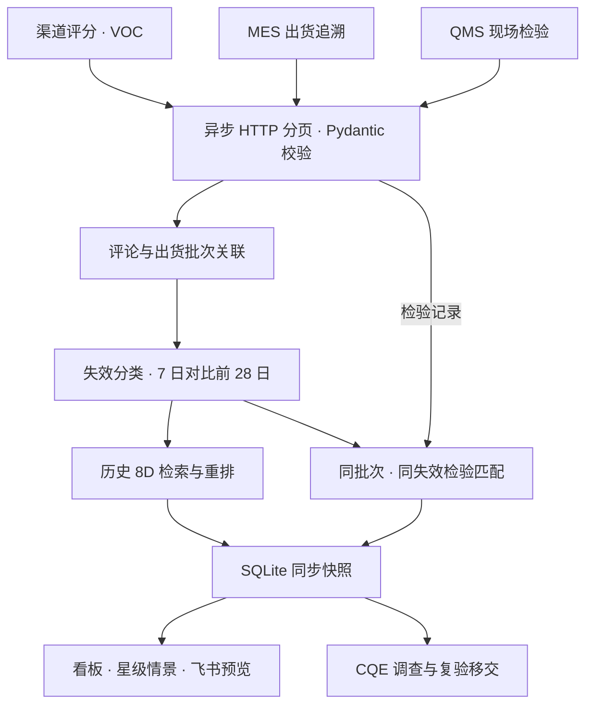

# Crossborder CQE Sentinel

[](https://crossborder-cqe-sentinel.xtony.workers.dev/)

**面向智能硬件的 CQE 工作台，从海外电商差评预警追到出货批次与现场检验。**

将海外电商 VOC 与 MES 出货追溯、QMS 检验对齐，为 CQE / SQE / DQE 提供研判证据与历史 8D 建议。工程师按同批次复现证据移交复验，并用 Listing 星级情景评估整改优先级。

[打开合成演示（无需 API Key）](https://crossborder-cqe-sentinel.xtony.workers.dev/) · [本地一键启动](#本地运行与验收) · [查看评测](docs/evaluation.md)

[](https://crossborder-cqe-sentinel.xtony.workers.dev/)

## 演示验收结果

| 合成沙盒验收 | 结果 |
| --- | --- |
| 三源 HTTP 分页回放 | **408 条评分、13 条追溯、4 条检验**。80 条差评中 **77 条**关联批次 |
| 同批次质量证据 | 包装压溃 `LOT-PU-04`，`QMS-26-117` 角跌后 **3/6 件异常，已复现**。低温指纹 `LOT-ME-03`，`QMS-26-123` **1/5 件异常，检验观察**。[QMS 样例](data/demo_qms_inspections.json) |
| 异常恢复 | 追溯源 503，重试两次后本轮失败，上一成功快照继续可读 |
| VOC 与检索基准 | **89.8% Macro-F1**（58 条）。8D **Recall@3 / MRR@3 均为 1.000**（11 条有标签的检索题，库内 5 案例） |

同进程合成上游及三个独立进程的配置化联调均已通过。开发者可核对 [数据接入契约](docs/integration.md)，也可按 [面试演示路径](docs/interview.md) 查看每一项证据。

## 它解决什么

| CQE 的实际问题 | 工作台提供的证据与动作 |
| --- | --- |
| 包装内衬问题和承运撞击都可能表现为到货有划痕 | 保留英文或双语原句和触发词位置，区分失效模式。以追溯引用关联供方和批次 |
| 指纹低温异常条数少，手工拉表容易错过增长 | 对比同 SKU、同供方近 7 天和此前 28 天的比例及日均条数，列出样本分母与回放日期 |
| 历史 8D 看起来相关，现场证据仍待核实 | 检索结果附 D4/D5/D6 与重排分。只有同 SKU、批次、失效代码的 QMS 记录才进入当前告警 |
| 质量团队需要说明整改对 Listing 有什么价值 | 全星级样本用于估算当前星级，按未来 30 天的未整改情景计算挽回幅度 |

## 本地运行与验收

需要 Python 3.11+。在仓库根目录执行对应命令，再打开 [CQE 工作台](http://127.0.0.1:8001/)。首次安装依赖需要网络，前端资源随仓库提供。若 8001 已被占用，可设置环境变量 `PORT` 并用对应端口打开工作台。

**macOS / Linux**

```bash
./start.sh
```

<details>
<summary>Windows PowerShell</summary>

```powershell
py -3 -m venv .venv
.\.venv\Scripts\python.exe -m pip install -r requirements.txt
.\.venv\Scripts\python.exe app.py
```

</details>

### 从一条差评追到批次证据

本地和公网演示均可沿以下路径查看证据。

1. 点 **同步三源**，再点 **查看 3 条未关联差评**，核对原记录和未关联原因。打开 **快照 JSON** 可核对输入 SHA-256。
2. 展开 **包装内衬压碎**，沿评论原句查看 `TR-LOT-PU-04`、`QMS-26-117` 和历史案例 `8D-002`。填写备注并开始调查，有同批次复现证据时可提交复验。
3. 点 **回放来源故障**，查看追溯源重试、失败状态与保留的成功快照。通过 **导入 CSV / 模拟实时抓取** 追加 5 条包装破损差评，观察预警与排行变化。

### 命令行验收

验收使用随机本机端口和内存 SQLite，输出三源条数、两条告警的 QMS 证据及故障后快照回读结果。

```bash
./start.sh --verify-demo
```

Windows 验收命令为 `.\.venv\Scripts\python.exe -m benchmarks.smoke_http --standalone`。

接口文档可直接打开 [本机 OpenAPI](http://127.0.0.1:8001/docs)。

## 数据流与状态

下图对应本地 Python 工作台。公网 Workers 使用同一引擎生成的合成回放结果。[在线演示部署](#在线演示部署)



- **同步状态**从受理、拉取到分析。三源全部通过校验才提交成功快照。请求幂等键复用同一任务，失败与重启中断可以回查。
- **调查状态**从待研判、调查中到已提交复验。保存备注和版本，只有同批次同失效的复现记录才可提交复验。正式根因、措施有效性与结案依现场 QMS 流程。
- **规则和模型**共享分类枚举与失效代码。模型输出要通过 Pydantic、评论 ID 覆盖和原文定位。已知失效另过可观察证据门槛。低温指纹要求同时出现指纹、低温和识别下降线索。
- **历史方案**先排除分类冲突和当时尚未结案的案例。TF-IDF 召回后按词相似度、检索词覆盖和失效代码重排，低分弃答。展示既有 D4/D5/D6 原文。

## 评测与可复现命令

```bash
.venv/bin/python -m unittest discover -s tests -v
.venv/bin/python -m benchmarks.evaluate --format markdown
./start.sh --verify-demo
```

评测包含未见表达、否定语句、无匹配案例、案例结案日晚于回放日，以及逐日窗口。8 个回放日检出 2/2 处植入信号，距首条植入分别为 **1 天和 3 天**，另有 **1 条额外告警**。分母、逐类结果和错例均可回查。[评测报告](docs/evaluation.md)

[GitHub Actions 工作流](.github/workflows/validate.yml)使用 Python 3.11 和 3.12 执行单测、评测报告对拍与真实 HTTP 冒烟。本仓库基准使用规则引擎和本地检索，兼容模型使用模拟响应检查契约和拒答行为。

## 导入真实电商评论 CSV

1. 下载有权限使用的评价导出。如果要看星级，导出同一观察期间所有星级，包括无正文评分。
2. 保留唯一的 `review_id`，映射 `date`（`YYYY-MM-DD`）、`sku`、`stars`（1–5）和 `review_text`。可补 `brand`、`supplier` 和 `lot`，以订单或追溯记录填充。缺失显示「未标注」。
3. 保存为 UTF-8 逗号分隔文件，可带 BOM，最大 5 MiB。双引号、逗号和正文换行按 CSV 转义保留。
4. 点击 **导入 CSV / 模拟实时抓取** → **导入并分析**。文件包含全量星级时勾选对应选项。模拟新增 5 条只作用于示例视图，可返回上次导入结果。

默认无密钥规则运行。有正文的低星评价可用 `DEMO_MODE=0` 发送给配置的兼容模型。模型仅收评论编号和正文，使用真实文件前应对正文脱敏。CSV 分析结果留在当前进程，三源同步快照和研判记录保存在本地 SQLite。[字段契约和环境变量](docs/integration.md)

## Listing 星级口径

**当前加权星级**用各星级的评价数加权。**30 天挽回**是整改情景和同一时期未整改情景的差值。两个情景均沿用近 7 天评价量和构成，假设关联到 8D 的失效中，70% 的后续低星评价改善到 5 星。历史评价保留原星级。示例 `SL-Pro-US` 为 **4.1★**，在该情景下 **+0.4★**。差评占比用于质量排查，估算故障率需销量或在网量分母。Amazon 页面采用自身模型并考虑时效、核验购买等因素。[Amazon 的评分说明](https://sellercentral.amazon.com/seller-forums/discussions/t/9629cd2e-3989-46b4-80ae-aa87fafc8cd1)

## 在线演示部署

[打开 Cloudflare Live Demo](https://crossborder-cqe-sentinel.xtony.workers.dev/)。默认开启无密钥的合成演示，支持三源同步、503 故障回放、批次证据与 8D 查看、调查与复验、飞书卡片预览、内置 CSV 导入和模拟追加。真实评价与企业接口在本机工作台接入。

部署构建由 Python 引擎生成合成回放结果。Cloudflare Worker 在运行时逐页核验三源指纹，再发布对应快照。每个访客的操作由 SQLite Durable Object 分开保存，演示会话有效期为 12 小时。部署使用 Workers Free 支持的组件。[Workers Static Assets](https://developers.cloudflare.com/workers/static-assets/) · [Durable Objects 免费层](https://developers.cloudflare.com/durable-objects/platform/pricing/)

从 macOS 或 Linux 部署需要 Python 3.11+、Node.js 和已登录的 Cloudflare 账号。在仓库根目录执行部署命令，Wrangler 会调用 `./start.sh --build-cloudflare` 生成静态资源与回放快照。

```bash
npx --yes wrangler@4.165.0 deploy --config wrangler.jsonc
```

以下命令验收已发布的演示。验收自己的部署时，使用 Wrangler 返回的 URL 作为 `--base`。

```bash
.venv/bin/python -m benchmarks.smoke_cloudflare --base https://crossborder-cqe-sentinel.xtony.workers.dev
```

公网接口文档可从 [Cloudflare 演示 API](https://crossborder-cqe-sentinel.xtony.workers.dev/docs) 打开。

## 代码入口

| 模块 | 职责 |
| --- | --- |
| [`adapters/`](adapters/) | Pydantic 来源契约、HTTP 分页与合成上游 |
| [`service/`](service/) | 异步同步、批次关联、快照存储、研判状态、OpenAPI |
| [`core/`](core/) | 分类、预警、检索重排、星级情景 |
| [`static/`](static/) | Tailwind / Chart.js 工作台和可回查原文 |
| [`benchmarks/`](benchmarks/) · [`tests/`](tests/) | 标签集、离线评测、HTTP 冒烟和故障验证 |

[MIT License](LICENSE) · 供应商、SKU、检验记录和评论均为虚构。前端第三方授权文本见 [vendor](static/vendor/)。
