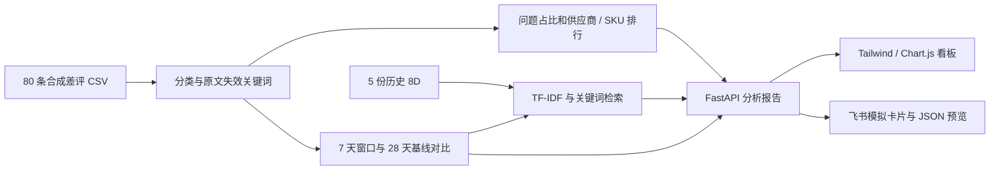

# Crossborder CQE Sentinel

海外跨境电商 VOC 质量归因与早期预警 Agent。它把海外平台的低星评论归到可排查的失效模式，按 SKU 和供应商找出短期增长，再调出历史 8D 的根因、整改措施和验证记录。CQE 可据此优先跟进影响 Listing 星级的重复客诉，并在整改后结合全量星级数据评估效果。

演示包含 80 条 1–2 星英文或中英双语评论和 5 份完整 8D。品牌 `Brand-Mock`、SKU、供应商、批次及案例数据均为虚构。预警报告描述差评样本中的变化，实物、批次追溯和检验记录用于确认当前根因。

## 一键启动

安装 Python 3.11 或以上版本。在项目目录运行以下命令，然后打开 [本地看板](http://127.0.0.1:8001/)。

```bash
./start.sh
```

首次启动会创建 `.venv` 并安装依赖。默认启用 `DEMO_MODE=1`。Tailwind 样式和 Chart.js 已编译或随项目交付，依赖安装结束后可以离线演示。停止服务时按 `Ctrl+C`。

Windows 可在 PowerShell 中执行。

```powershell
py -3 -m venv .venv
.\.venv\Scripts\python.exe -m pip install -r requirements.txt
.\.venv\Scripts\python.exe app.py
```

## 系统架构



- [`core/tagger.py`](core/tagger.py) 用规则或模型为每条差评提取一个主类和原文关键词。Pydantic 校验类别、失效代码及字段结构，模型结果额外核对评论编号与关键词原文。分类支持来料不良、包装破损、功能故障和物流损坏，证据不足的评论进入待复核。
- [`core/alert_engine.py`](core/alert_engine.py) 按问题类别统计构成，按供应商和 SKU 排差评条数，并对同一 `SKU × 供应商` 下的失效分别比较两段时间。已知模式使用标准失效代码，其他现象按类别和首条标准化关键词聚合。
- [`core/rag_8d.py`](core/rag_8d.py) 用英文词和中文双字词做 TF-IDF，结合检索词重合度。在同类且截至当日已结案的案例中返回最相似的记录，并附 D4 根因、D5 措施和 D6 验证。低于阈值时提示人工排查。
- [`app.py`](app.py) 在启动时生成报告。看板提供两种排行、可展开的 8D 原文证据和飞书模拟预览。`/api/report` 返回分析结果，`/api/feishu-preview` 返回本地模拟的交互卡片 JSON。卡片结构参考 [飞书自定义机器人使用指南](https://open.feishu.cn/document/ukTMukTMukTM/ucTM5YjL3ETO24yNxkjN?lang=zh-CN%2C)。

## 预警规则

CSV 列为 `review_id,date,brand,sku,supplier,lot,stars,review_text`，`date` 使用 `YYYY-MM-DD`。分析入口纳入 1–2 星评论，默认以样本中最新的差评日期为回放终点。日窗口包含起止日，近 7 天含终点，基线为紧邻且无重叠的此前 28 天。批次用于追溯，比较分母使用同一 SKU 与供应商在各自窗口的全部差评。

| 条件 | 触发规则 |
| --- | --- |
| 最小样本 | 近 7 天至少 6 条差评，基线至少 10 条差评 |
| 苗头关注 | 近 7 天同一失效至少 3 条，占比上升至少 15 个百分点。基线有命中时，占比和日均条数均达到基线的 2 倍 |
| 重点预警 | 满足苗头条件，且近 7 天同一失效至少 6 条，占比上升至少 30 个百分点 |

基线有足量差评但该失效为 0 条时，使用条数与占比增幅判断。环形图以已归类差评为分母，排行以全部样本差评为分母。评估实际故障率与 Listing 星级变化还需关联销量和全星级评论。

## 复现演示结果

在终端输出完整 JSON，或指定历史日期回放。

```bash
DEMO_MODE=1 ./start.sh --analyze
DEMO_MODE=1 ./start.sh --analyze --as-of 2026-11-12
```

截至 `2026-11-19`，80 条评论全部归类，触发两条预警。回放到 `2026-11-12` 时有 55 条差评，预警数为 0。

| 预警 | SKU / 供应商 | 近 7 天 | 28 天基线 | 对应历史案例 |
| --- | --- | ---: | ---: | --- |
| 重点预警 · 包装内衬压碎 | `SL-Pro-US` / `Supplier-A` | 8/12（66.7%） | 1/24（4.2%） | `8D-002` EPE 内衬与跌落验证 |
| 苗头关注 · 指纹低温识别率下降 | `SL-Max-EU` / `Supplier-B` | 3/8（37.5%） | 0/17（0.0%） | `8D-004` 密封压合与低温验证 |

包装异常集中于 `LOT-PU-04`，8 条均出现在最后 5 天。低温指纹评论集中于 `LOT-ME-03`。点击预警或展开 8D 卡片可核对批次和评论原文样例。

```bash
.venv/bin/python -m unittest discover -s tests -v
```

## 接入 OpenAI 兼容接口

将 `OPENAI_API_KEY` 设为本地环境变量，再指定服务地址和模型。地址填写包含服务版本的 API 根路径，程序会追加 `chat/completions`。服务不支持 JSON 对象模式时可设置 `OPENAI_JSON_MODE=0`，Pydantic 校验仍然生效。[Chat Completions 接口文档](https://developers.openai.com/api/reference/resources/chat/subresources/completions/methods/create)

```bash
export OPENAI_BASE_URL='https://api.openai.com/v1'
export OPENAI_MODEL='<服务商支持的模型 ID>'
DEMO_MODE=0 ./start.sh
```

兼容模式按批向已配置的模型服务提交评论编号与原文。SKU、供应商、星级和批次字段用于本地统计。每次服务启动都会重新生成报告。本项目已用模拟 HTTP 响应验证接入格式与异常结果拦截，线上模型需要用所选服务完成联调。

## 文件与前端构建

- [`data/amazon_reviews_mock.csv`](data/amazon_reviews_mock.csv) 保存 80 条差评及原始批次字段。
- [`data/historical_8d_kb.md`](data/historical_8d_kb.md) 保存 5 份 D1–D8 案例，涵盖来料虚焊、EPE 包装跌落、固件防误触、指纹低温和物流碰撞。
- [`static/`](static/) 保存页面和已构建的前端资源，第三方授权文本随 `static/vendor/` 提供。

修改页面样式后可用以下命令重建 Tailwind 样式。[Tailwind CLI 文档](https://tailwindcss.com/docs/installation/tailwind-cli)

```bash
npm install --no-save --no-package-lock tailwindcss@4.3.5 @tailwindcss/cli@4.3.5
npx tailwindcss -i static/tailwind.css -o static/dashboard.css --minify
```
